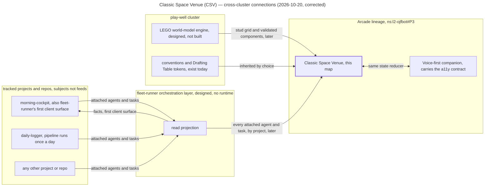

# Wayfinder — Classic Space Venue (CSV), the Classic Space agent world

## Destination

The project is named **Classic Space Venue (CSV)** (ruled by Yuri, 2026-10-20; the slug above is
immutable identity and does not change). The Arcade gains an ambient venue. A Classic Space server room — 1980s LEGO space illustration,
blue spacemen, black contours — runs all day on a desk monitor, and every minifig in it is a real,
named ojfbot agent, process or queue. A glance reads status; selecting a figure or place reveals
the real entity, its task and its evidence; a plain dashboard/text view renders the same state in
parity; a stale or disconnected feed says so in both surfaces. **Arrived** = one cluster room bound
to one real read-only fleet feed, two or more minifigs on independent validated routes, the plain
view in parity, deterministic replay for regression, and layout, labels and overrides that survive
restart. Serves `ns:l2-ojfbot#P3` (the Arcade fronts the fleet) and `ns:l2-ojfbot#P1` (each app
reaches a usable surface in its natural venue). The minifig is the flâneur of the Arcade's own
naming register (name the operating surface, #273).

It is a **novel representation stack over the same shared agent state** the rest of the fleet
reads — a UI layer, not a second source of truth. Its **only feed is fleet-runner's
orchestration layer**: the venue tracks every agent and task attached to projects and repos as
fleet-runner reports them, and has **no direct dependency on any project repo**. morning-cockpit
is fleet-runner's first client surface; this venue is a sibling consumer on the same read seam,
never a reader of cockpit. The **play-well cluster is the engine for building any LEGO world
model**, so the room's geometry, stud grid and validated components integrate closely with
play-well's tooling rather than growing a private world model. It is **resolutely visual** and built as a design experiment for the operator
alone. A **voice-first companion surface** runs side by side with it, equal in *capability*
(every entity, state and action the scene shows is reachable by voice) and accessible at all
times; the accessibility-tree contract governs the companion, and the canvas is exempt. First
proof tracks the agents and tasks attached to **morning-cockpit** and **daily-logger** — as
subjects seen through fleet-runner, not as feeds. Because fleet-runner has no runtime yet, how
the first proof is fed until its read projection exists is a ticket, not an assumption.

The initiative consumes the play-well cluster's tools — Drafting Table tokens, the LEGO building
UI, Blender expertise — as a client cluster and contributes features back, the way other clusters
are meant to consume blogengine's publishing harness without joining its cluster. It does not join
play-well's correspondence register unless the repo-home ticket rules otherwise. Siri as a
transport, camera moves, node authoring and further rooms are beyond arrival (see fog and
out-of-scope below).

## Notes

- **Mode:** full (core registry resolves, 26 entries). Charted 2026-10-20 from
  `lego-village-pipeline` as the vantage; the map lives here in the one library.
- **Source bundle:** `~/Desktop/classic-space-walkway-pass` — a ChatGPT-session handoff with
  honest provenance: a Three.js projection scene (approved plate camera-projected onto rough
  solids), one procedural rigid minifig on one route, fixed art camera, 36 s loop at 24 fps;
  Chromium captured, FFmpeg encoded; **Blender never ran**; no fleet schema inspected. Read
  `START_HERE.md`, `AGENTS.md`, `handoff/PRODUCT_VISION.md`, `handoff/OJFBOT_WORLD_COMPILER.md`,
  `handoff/KNOWN_LIMITATIONS.md`, `handoff/NEXT_LAYOUT_CHANGE.md`. The bundle's `AGENTS.md`
  standing rules (preserve the visual contract; work honestly and incrementally; never claim a
  Blender run or render without evidence) are inherited verbatim as working constraints.
- **Visual-evolution companion bundle (arrived 2026-10-20 17:40):**
  `classic-space-visual-evolution/` beside the source bundle — 13 AI raster studies with a hashed
  `manifest.json`, `START_HERE.md`, `FIRST_PRINCIPLES.md`, `DESIGN_EVOLUTION.md`,
  `AGENT_HANDOFF.md`, `GALLERY.html`. No geometry, rig or scene was built; sequence numbers, not
  file timestamps, are the order of record. **It supplements the first batch; it does not
  replace it** (operator correction 2026-10-20) — the walkway scene, its source, route,
  continuity checks and loop remain the first-pass baseline. What it adds: (1) a **preferred
  routine-interaction place**: the eye-level nested collaboration bay (12 realistic, 13
  illustrated) — suspended rack islands on visible rods with air gaps, seated agents at low
  consoles, distinct work pockets, a green glass office, larger complex visible beyond; precedent
  Alberto Kalach's Biblioteca Vasconcelos. The bundle frames it as a nested area within a much
  larger complex, of which the walkway is part; it has no source geometry yet. (2) **Three-system
  semantics** that extend the first pass and supersede only the tentative green-as-observation
  reading: they
  the earlier table: blue = bulk application/user space; yellow = hygiene collection, logging,
  deep archive, cleanup, safe/secure deletion; dark oxygen-green = isolation, privacy, secure
  privilege. Color is domain, never status; actor color is not authorization; a rendered gate is
  not implemented authorization. (3) The AI image attempts at the walkway's perpendicular yellow
  branch (01–02) and a green-to-yellow ramp (03–04) are **discarded** as pictures ("do not resume
  without a new geometric layout study"); the `NEXT_LAYOUT_CHANGE.md` brief itself stands and
  proceeds through geometry, never from those images. (4) **Two presentation modes** —
  molded plastic and illustrated manual — are wanted over one scene; the pairs are style studies,
  not a proven switch. (5) Worm-eye (09–10) has no interface value; bird-eye (11) is an optional
  macro overview. (6) Suspended-rack contract: rods/brackets, cabinet bottoms clear the floor,
  interaction height, reach and route headroom solved together.
- **Why "fork from LVP" is weaker than it sounds.** LVP is a procurement digital twin that spends
  real money against a BOM; this is an ambient agent-ops venue. What carries over is conventions
  (teacher principle, evidence axes, a11y-tree contract, Drafting Table tokens at
  `docs/design/H-01-R1/dt/tokens.css`, mock-math labelling, people rules: James is a friend of
  the family, never a parental role; the boys are EH, HH, LH), not domain. The real precedent is
  the Arcade lineage.
- **The Arcade is the home, by name already.** `operating-surface-bonded-pair` (#272) closed
  "name the operating surface" (#273) on 2026-07-23 with Benjamin's *Arcades Project* as the
  register: one passage, many worlds; the operator as flâneur. No visual "see the fleet" attempt
  has been filed under it: `core-library` (May 2026, "3D cyberspace navigation UI for deployed
  apps + running agents", Babylon, wireframe Cambridge UL aesthetic) is a three-commit seed with
  undeclared scope and no northstar; cockpit tiles and gastown-pilot are separate apps. This map
  is the first Arcade *venue* initiative. Cross-map dependencies: registry schema home (#275) and
  tier B talk seam (#281) remain open there.
- **"The ojfbot schema" does not exist as one thing.** fleet-runner is design-only
  (`fleet-runner/` holds planning and research; placement approved in core as
  `packages/fleet-runner`, ADR-0108; no runtime). What is observable today: the live Claude Code
  session census (the UserPromptSubmit hook lists ~40 worker agents by repo), beads under
  `.handoff/` (typed, dated, with refs and status), `decisions/northstar/status.jsonl`
  (movement ledger, sparse), the northstar registry and roadmaps, GitHub issues/PRs/sub-issues,
  the daily-logger sweep. The first feed is a research question, not a lookup.
- **Two engines, both designed-not-built (2026-10-20).** fleet-runner has no runtime; its
  planning names cockpit's existing REST `/api/cockpit` as the first publication path (a
  read-only evidence card), which makes cockpit the first client and this venue the second,
  sharing that seam. The play-well cluster has no world-model code yet: LVP's `tools/` are
  register, preflight and design-package tooling, its roadmap's only slice is the Q13 railbed
  geometry check, and the LEGO world-model engine (ldraw-nova precedent, stud-grid geometry,
  validated components) is a research-lane vision under the 2026-10-21 ORDER-BY gate. The venue
  depends on fleet-runner alone for facts (operator ruling, fourth round), so until fleet-runner's
  read projection exists the venue has **no live feed at all**; the bridging ticket decides
  whether that means waiting, a labelled fixture in fleet-runner's object shape, or building the
  read projection as this venue's first contribution. The proof never claims either engine is in
  the loop until it is.
- **Posture (operator, 2026-10-20).** This runs **in parallel** with lego-village-pipeline, not
  instead of it: it supports LVP by being a real consumer of play-well's tools and contributing
  features back, it keeps the operator excited (a fun project), and it ends as a good addition
  running on a desktop monitor. fleet-runner and its working clients (morning-cockpit, which
  already exists in an unwired state, and the Classic Space Venue) are **quick fast follows** in
  the operator's view. Precision on that claim: the venue needs only fleet-runner's **read
  projection** (facts about agents, attempts and tasks attached to projects), which can ship far
  ahead of fleet-runner's authorization, restoration and publication contracts (Q1–Q7); the
  fast-follow is credible for the read side, and the read side is all this venue needs. Scope
  every ticket session to this appetite (vault: `concepts/appetite`): small, parallel, delightful,
  never a second orchestration layer.
- **The read projection already half-exists (facts gathered 2026-10-20 for the bridging
  ticket).** morning-cockpit's `packages/shared/src/work-item.ts` defines `WorkItem` — a
  unified shape every source normalises into (Dolt beads, `.handoff` beads, GitHub, standup):
  kinds `agent | convoy | task | pr | session | brief | report | decision | discovery | issue |
  pull_request | priority`, status `running | open | done | stale | failed | unknown`, `actor`,
  `repo`, `claimedBy`/`leaseUntil`, provenance refs, and per-adapter `AdapterHealth`
  (`up | down | degraded | disabled`). `CockpitSnapshot` is served by `GET /api/cockpit` from
  cockpit's Express server (launchd-hosted). fleet-runner's **only** planning slice, MC-UX-01
  (`fleet-runner/planning/mc-ux-01/`, operator-confirmed REST boundary 2026-10-08, implementation
  not yet authorised), is built explicitly over that snapshot: "one shared projection over the
  REST snapshot." Cockpit's own roadmap already holds the producer-wiring slices in `ready`
  state: S1 (GitHub adapter into the aggregate), S2 (fleet sessions emit `agent-*` bead events
  end-to-end), S10 (registry adapter), S11 (derived-truth selectors). Caveats: `WorkItem` carries
  cockpit view semantics (the three lanes) that are not fleet facts; `agent`/`session` items come
  from Dolt beads, so live agents appear only once S2 lands and Dolt is up. Consequence for the
  venue: the honest "temporary adapter" is not new code in the venue — it is lifting the snapshot
  contract (facts + health, minus lanes) to the approved fleet-runner home in core and treating
  cockpit's server as the *temporary host* of that contract behind a configurable URL.
- **Governance fact:** `REGISTER.md` scope text — "the play-well cluster, not one repo … and any
  further play-well repo" — means calling this repo play-well pulls it under memo preflight,
  register versions and relay-only self-merge. Membership is a decision (repo-home ticket).
- **Vault reads (design-time, read-only):**
  - `synthesis/play-well-research-harness` — the decomposition alarm and innovation alarm apply
    to any "ahead of the field" claim this venue makes; keep candidate modules as findings until
    decided.
  - `concepts/blender-era-3d-work` — the practice's craft → script → agent arc; a 2019 "rough
    server-room blockout" and a 2021–22 LDraw import pipeline are literal ancestors of this room.
  - `synthesis/cluster-status`, `synthesis/ojfbot-ecosystem-map` — the `core-library` seed and
    `asset-foundry` (LangGraph → bpy → validated .glb, generic by construction) as the fleet's
    Blender capability.
  - `synthesis/fleet-runner-design-contracts` — user story 8 ("truthful blocked, unknown and
    stale states so process health does not masquerade as progress") is the fleet's own statement
    of this venue's honesty rule.
- **Standing constraints carried from the handoff:** a walking minifig never implies a live task
  succeeded; a metaphorical walk down a garbage lane never itself triggers deletion; queue visuals
  may aggregate while the dashboard keeps exact counts; simulation time stays separate from render
  frame rate; mock data is labelled simulated.
- **Tooling pointers (not endorsements):** Mint MCP / mint-threejs-skills, `ahujasid/mcp-for-blender`,
  the Blender MCP connector attached to this session, `asset-foundry`'s subprocess bridge. Evaluate
  any generator on one small module before widening (handoff `TOOLS_AND_PRECEDENTS.md`).

## First strand: the world-building pipeline

Operator direction, 2026-10-20 (fifth round): **before** interface work and agent binding, build
the pipeline that turns a still image into a navigable, filmable world — "static image to
blender world to renderable app/browser deliverable". Blender is the world hub. Character
objects then perform parametric, procedural actions driven by world state, events, and
operator or agent inputs, plus easter-egg world-building behaviours that bring the room to life.
The pipeline accrues assets over time: more characters, poses, props, and rigging sheets.

| Step | What it produces | Map tickets |
|---|---|---|
| 1. still image | art plate or style plate; character rigging-sheet generation | Image-first or layout-first (#564); Presentation modes (#559) |
| 2. Blender world | layout, solids/voids, walkable surfaces, rig, poses, motion, both material modes | Blender as world hub (#544); Authoritative spatial source (#551); Nested bay alongside the walkway (#558) |
| 3. paths | routable areas, lanes, portals, clearances | Two-agent route proof (#545); Three-system semantics (#553) |
| 4. actions | parametric, procedural actions at places; easter eggs | Action model (#566); NPC versus bound agents (#562) |
| 5. asset library | accrued characters, poses, props, rig sheets, plates, with provenance | Home and format of the accrued world-asset library (#565) |
| 6. runtime deliverable | browser build and native app, screensaver-grade performance | Rendering and motion stack (#563); Ambient hosts (#550) |

How the pipeline is orchestrated by agents is a research question first: Multiagent
orchestration for game-asset and world-building pipelines (#567), filed to the play-well
research harness as RFI-0002. The dev-host below is the pipeline's always-running viewer, not a
separate product.

## Standing strand: the dev-host

Operator direction, 2026-10-20: one strand **always** keeps a dev-host up and running, as quickly
as possible, so the other strands are never blocked on each other. The dev-host functions on
**mocked data only**, and degrades gracefully: full (interactive, composable, mock-bound) → no
interactivity → no dynamic composability → **a static running screensaver** at minimum. It is the
workbench for the rendering and world-building flow:

| Stage | What it is | Map tickets / fog it touches |
|---|---|---|
| (a) generate source image | the art plate (today: AI still, approved plate in the bundle) | Presentation modes at arrival (#559); generative asset tooling (fog) |
| (b) extrude to depth | plate projected onto rough blocked solids (today: Three.js projection) | Blender's role in the loop (#544) |
| (c) build into navigable world volume | authoritative solids/voids, levels, supports | Authoritative spatial source (#551); Nested bay alongside the walkway (#558) |
| (d) build routable path areas | lanes, portals, clearances, reservations | Two-agent route proof (#545); Three-system semantics (#553) |
| (e) build actions at places | inspect, carry, wait, acknowledge, seated console work | State vocabulary (#552); interaction vocabulary (fog) |
| (f) seed NPC behaviours | unbound minifigs "maintaining" and "monitoring" the environment | NPC behaviours versus bound agents (#562) |
| (all) render and move it | Three.js / Blender / motion tooling, browser **and** native macOS, screensaver-grade performance | Rendering and motion stack for browser and native macOS (#563); Ambient hosts (#550); Blender's role (#544) |

Rules for the strand: mock data is a **workbench input, labelled simulated in scene and
companion, and never counts toward arrival** (the bridging ruling's "no fixture" stands: it
concerned the arrival feed, not the workbench); the walkway viewer in the bundle
(`walkway-pass/walkway-layout.html`, self-contained, 36 s loop) already satisfies the static
floor, so **dev-host v0 is a host around what exists**, gated only by where it lives (Repo and
northstar home, #542) — and even that can be deferred with a local `git init`, no remote, no
registration, until the home ticket rules. Dev-host v0 is a delivery, not a ticket; it is listed
with the other deliveries below.

## Integration notes (cross-cluster)

Operator instruction, 2026-10-20: this is one of the first initiatives with robust overlapping
concerns and one-to-many connections between clusters (Arcade lineage · fleet-runner via the
cockpit seam · play-well as world-model engine · daily-logger as a tracked subject). Keep notes on how the
integration behaves, the patterns established, the friction points, and how to integrate such
processes going forward. **Convention:** friction met while working a ticket or slice goes to
`implementation-notes.md` `## Deviations` in the repo where it happened (the fleet's existing
roll-up finds repeats); patterns and seams get a dated bullet here while the map is open; at
handoff this section graduates to a vault synthesis (candidate: `cross-cluster-consumer-pattern`)
and, where a convention emerges, an ADR. Seeded from this charting session:

- **Subjects are not feeds.** "Track cockpit and daily-logger agents" was read by the agent as
  "read cockpit's and daily-logger's state", and drawn that way; the operator corrected it the
  same evening: the venue reads **only** fleet-runner's orchestration layer, which reports the
  agents and tasks attached to any project or repo. Pattern: one-to-many across clusters goes
  through the orchestration layer, with zero per-project adapters in the consumer; cockpit is a
  sibling consumer of that layer, not an upstream. Friction: the layer is designed-not-built, so
  the venue currently has no live feed at all — a dependency on another initiative, charted as the
  bridging ticket rather than worked around.
- **Engines that do not exist yet.** Both named engines (fleet-runner runtime, play-well world
  model) are visions with research behind them. Pattern: name the seam, run the proof on what
  exists, never claim the engine is in the loop. Friction: every ticket touching those seams
  carries a "now vs later" split.
- **Client-neutral read contract (2026-10-20 onboarding review, proposed).** A second consumer exposed cockpit lane-derived fields and cockpit-local identity in the proposed lift; route neutral fact shape, stable identity, freshness and health semantics to #561/#543 for owner review before binding, without treating mock data as arrival.
- **Governance by label.** A cluster's register can claim a repo by scope text alone. Pattern:
  cluster membership is a decision ticket (home), decided before any landing, not inferred from
  aesthetic or tooling overlap.
- **Contracts that assume a DOM.** LVP's a11y-tree-as-agent-contract cannot see a WebGL canvas.
  Pattern: the contract moves to a companion surface equal in capability. Friction: "equal" needs
  a definition per surface pair.
- **The blogengine-consumer pattern is still a vision.** Operator framing: other clusters consume
  blogengine's publishing harness without joining its cluster. No cluster does so yet, so this
  venue may be the first realisation of that pattern and should record what it takes.
- **Where cross-cluster work lives.** Today the only neutral home is this map in core's library.
  Friction: the source bundle sits on the Desktop with no git history until the home ticket rules.
- **"Preferred" is not "supersedes".** The visual-evolution bundle supplements the first pass;
  the agent's first reading (2026-10-20) treated the preferred bay as replacing the walkway,
  demoted the two-agent prototype off the frontier and struck a pending delivery, and the operator
  corrected it within the hour. Pattern: a companion bundle must state its relation to the prior
  batch (supplement / supersede / partial) per artifact, and an agent reads "preferred" as
  "additionally wanted" unless told otherwise. What this bundle does supersede is narrow: the
  tentative green-as-observation reading and four discarded image attempts. Pattern worth keeping
  from it: a hashed manifest with sequence-based ordering and explicit `status` per artifact
  (discarded / limited-value / exploration / preferred). Friction: two unversioned bundles on the
  Desktop with the relation stated only in the newer one; the map carries the reconciliation until
  a repo exists.

### Who feeds whom (context view, 2026-10-20)

**Caption:** For the operator: what the Classic Space Venue depends on, and in which direction
facts flow. Notation: a dependency/context view drawn as a Mermaid flowchart, not C4 or OPM. Key:
a label ending in "designed, no runtime" or "designed, not built" marks a thing that does not
exist yet; an edge label ending in "later" marks a connection that is planned, not live; the
accent-bordered node is this map's subject. Takeaway: the venue has exactly one fact source,
fleet-runner's orchestration layer, which reports the agents and tasks attached to any project;
there is deliberately **no edge** from any project to the venue, and morning-cockpit appears as a
tracked project that is also fleet-runner's first client surface. Play-well supplies conventions
now and the world-model engine later. Omitted: Siri, Blender's role, the correspondence register,
the Arcade map's own open tickets. Corrected 2026-10-20 (fourth round): an earlier version drew
cockpit and daily-logger as direct feeds; that was wrong. Rendered with `@mermaid-js/mermaid-cli`
11.4.2 (`securityLevel: strict`, `htmlLabels: false`).

## Decisions so far

Grill-resolved at charting (recorded here as pre-map rulings by Yuri, 2026-10-20, not closed
tickets):

- Home lineage is the **Arcade**, as the next iteration attempt; play-well is consumed as a tool
  well, blogengine-consumer pattern — ruled in the charting grill (anchor `ns:l2-ojfbot#P3`, `#P1`).
- Arrival requires **one real read-only feed**, not replay alone and not Siri — ruled in the
  charting grill.
- Camera moves/transitions, node-based room authoring and multiple rooms are **out of scope** —
  ruled in the charting grill.
- Second round, same session: the scene is **resolutely visual and for the operator alone**; the
  a11y-tree contract is carried by a **voice-first companion surface**, equal in capability and
  accessible at all times, not by the canvas.
- Second round: the first proof tracks the agents and tasks attached to **morning-cockpit and
  daily-logger** (as subjects); the venue is a **representation stack over shared agent state**
  and binds to fleet-runner's object model rather than inventing a parallel schema (the handoff's
  Agent/Place/Lane/Task/Event proposal is a candidate projection, not the source model).
- Third round: **morning-cockpit is fleet-runner's first client surface**; this venue is a
  sibling consumer on the same read seam.
- Fourth round: the venue **runs fully independent of morning-cockpit and daily-logger** — it
  reads only fleet-runner's orchestration layer, which reports agents and tasks attached to
  projects and repos; no project repo is read directly. fleet-runner is not built yet (planning
  and research only, 2026-10-20), so the first proof's feed is an open ticket.
- Fourth round: the agent UI project is named **Classic Space Venue (CSV)**. Spell it out on
  first use in any document; "CSV" alone collides with comma-separated values.
- Third round: the **play-well cluster is the engine for any LEGO world model**; the room's
  spatial definition integrates closely with play-well's tooling as that engine lands, which
  raises (not settles) the register-governance question in the home ticket.
- From the visual-evolution bundle (operator rulings in the originating ChatGPT session, recorded
  in `DESIGN_EVOLUTION.md`, order by sequence number): images 12–13 are the **leading visual
  targets for routine interaction**, added beside the walkway first pass, not in place of it
  (operator correction 2026-10-20: supplement, never lose the first pass); the image attempts at
  the yellow branch and ramp (01–04) are **discarded as pictures**; the **three-system
  semantics** (blue/yellow/green) supersede only the tentative green-as-observation reading;
  worm-eye is not an interface camera. Recorded here as inputs; the bay-relation and semantics
  decisions stay with their tickets.

Closed tickets:

- **Lift the contract to fleet-runner**: cockpit's `WorkItem` + `AdapterHealth` + snapshot shape
  (facts and health, minus lanes) becomes fleet-runner read-projection v0 in
  `core/packages/fleet-runner`, versioned; cockpit's server is the temporary host behind a
  configurable URL; the venue binds to the contract, never to cockpit; owned by fleet-runner under
  core #307; paired with authorising cockpit S1/S2; no fixture — Bridging until fleet-runner's
  read projection exists (#560), ruled by Yuri 2026-10-20 in the charting session (operator
  ruling, not agent resolution). Cross-initiative slice proposed to fleet-runner's owner.
- **New L1 app, repo and northstar now**: `ojfbot/classic-space-venue` (private) founded with
  `l1-classic-space-venue` (P1 arrival → `ns:l2-ojfbot#P3`; P2 companion parity, P3 dev-host
  always runs → `#P1`), registered in core's registry on this map's branch; not a play-well
  member, not register-governed; play-well consumed as a client cluster — Repo and northstar
  home (#542), ruled by Yuri 2026-10-20 in the charting session ("we have enough foundation
  now"). Unblocked Arcade seam, Play-well consumption contract, Ambient hosts.
- **Open questions route to the play-well research harness as RFC/RFIs** (Claude-run, Codex-
  supported): filings live in the repo's `docs/rfi/`, harness numbering stays with the
  dispatcher, the decision stays with the ticket. First filing: RFI-0001 (NPC crew versus bound
  agents, serving #562). The browser/bundled-Node versus native-Swift fork is **deferred** by
  the operator ("another time, down roadmap as infrastructure capacity builds") — #563 stays a
  map research ticket, not an RFI — ruled 2026-10-20.
- Fifth round (2026-10-20): **the world-building pipeline comes first**, before interface work
  and agent binding. Its spine is still image → **Blender world** → renderable app or browser
  deliverable; Blender is the world hub, which narrows Blender as world hub (#544) to what it
  authors and its export contract. Assets accrue (characters, poses, props, rigging sheets);
  characters perform parametric, procedural actions from world state, events and inputs, plus
  easter eggs. Research is reordered accordingly: game-dev orchestration (#567) first, then the
  fleet-runner survey (#543), then the rendering stack (#563).

## Tickets

| Ticket (title, refer-by-name) | Type | Blocked by | Status |
|-------------------------------|------|------------|--------|
| Repo and northstar home (#542) | grilling | — | closed |
| What fleet-runner's orchestration layer will expose to a read-only consumer (#543) | research | — | open |
| Blender as world hub: what it authors and the export contract (#544) | grilling | — | open |
| Image-first or layout-first world building (#564) | grilling | — | open |
| Home and format of the accrued world-asset library (#565) | grilling | — | open |
| Action model: parametric actions driven by world state, events and inputs (#566) | grilling | — | open |
| Multiagent orchestration for game-asset and world-building pipelines (#567) | research | — (first in the research queue) | open |
| NPC behaviours versus bound agents (#562) | grilling | — | open |
| Two-agent route proof on the projection scene (#545) | prototype | — | open |
| Nested bay alongside the walkway: one complex, two places (#558) | grilling | — | open |
| Reacquire the measured minifig references (#546) | task | — | open |
| First feed binding (#547) | grilling | What fleet-runner's orchestration layer will expose to a read-only consumer | open |
| Bridging until fleet-runner's read projection exists (#560) | grilling | — | closed |
| Arcade seam (#548) | grilling | Repo and northstar home | open |
| Play-well consumption contract (#549) | grilling | Repo and northstar home | open |
| Ambient hosts (browser and native macOS) and display operations (#550) | grilling | Repo and northstar home | open |
| Authoritative spatial source (#551) | grilling | Blender as world hub: what it authors and the export contract; Two-agent route proof on the projection scene | open |
| Presentation modes at arrival (#559) | grilling | — | open |
| Rendering and motion stack for browser and native macOS (#563) | research | — (serialized behind #543 by the one-research-cycle rule) | open |
| State vocabulary and honesty rules (#552) | grilling | First feed binding | open |
| Three-system semantics: blue, yellow, green (#553) | grilling | First feed binding | open |
| Minifig fidelity bar (#554) | grilling | Reacquire the measured minifig references | open |
| Voice-first companion surface (#555) | grilling | State vocabulary and honesty rules | open |
| Room document and restart survival (#556) | grilling | First feed binding; Authoritative spatial source | open |

Frontier (2026-10-20, after the fifth round put the world-building pipeline first): Image-first
or layout-first world building · Blender as world hub · Home and format of the accrued
world-asset library · Action model · Two-agent route proof on the projection scene · Nested bay
alongside the walkway · Presentation modes at arrival · NPC behaviours versus bound agents ·
Reacquire the measured minifig references · Arcade seam · Play-well consumption contract ·
Ambient hosts. Research runs one cycle at a time, pipeline first: Multiagent orchestration for
game-asset and world-building pipelines (#567), then What fleet-runner's orchestration layer
will expose (#543), then the rendering and motion stack (#563).

Deliveries deliberately **not** on this map (they are roadmap slices once the decisions above make
their entrance statable): **dev-host v0** (a host around the existing walkway viewer with labelled
mock data and the static-screensaver floor; entrance is only a place to put it), the bundle's
proposed "small real scene" (one suspended rack island, two
collaboration pockets, several agents, both materials at one camera), the production two-agent
slice, the semantic vertical slice with replayed inspection and archive
tasks, character interaction clips, and the longitudinal yellow gangway layout pass (`NEXT_LAYOUT_CHANGE.md`, still pending — through a
geometric layout study, since its image attempts were discarded), and the baseline commit of both
bundles into whatever repo the home ticket names.

## Not yet specified

- **Siri as a transport** — operator intent is clear ("quick queries and interactions via Siri");
  the companion surface is now a ticket, but whether Siri fronts it is not statable until that
  ticket fixes the companion's API.
- **Feed cadence versus an animated room** — daily-logger's pipeline fires once a day; if
  fleet-runner reports only coarse attempt transitions, the room stands still most of the day.
  Whether finer progress (phases, the live session census) enters fleet-runner is fleet-runner's
  question, not this venue's; the survey reports what the designed projection carries.
- **Second fixed camera** — bird-eye (image 11) as an optional macro overview. The 2026-10-20
  out-of-scope ruling covers camera *moves and transitions*, not a second fixed camera; the
  question is not statable until the nested bay's relation to the walkway is decided.
- **Queue aggregation visuals** — how many items become one visual summary, and what the summary
  may hide; depends on the bound feed's queue shape.
- **Contribution path back to play-well** — which play-well tool receives its first feature from
  this consumer (tokens, building UI, Blender recipes); depends on the consumption contract.
- **Generative asset tooling** — whether Mint, `generate_3d` or asset-foundry supply candidate
  modules; depends on Blender's role.
- **Level connector behaviour** — lift/stairs traversal and reservations; depends on the
  authoritative spatial source.

## Out of scope

- **Camera moves and transitions** — ruled by Yuri, 2026-10-20 (charting grill). The art camera
  stays fixed until layout and behaviour are dependable.
- **Node-based room authoring** — ruled by Yuri, 2026-10-20. The world-compiler node editor waits
  until one real cluster compiles into agreed scene and dashboard state.
- **Multiple rooms** — ruled by Yuri, 2026-10-20. One room is the proof; rooms-as-clusters is a
  later initiative.
- **Worm-eye as an operational camera** — ruled by Yuri in the originating session (visual
  evolution images 09–10, "limited practical interface value"); kept as architectural study only.
- **The drawn yellow branch and ramp (images 01–04)** — discarded by Yuri in the originating
  session; retained as failure history, never reused without a new geometric layout study.
- **Family-facing use** — ruled by Yuri, 2026-10-20: "a design experiment and for myself." The
  people rules still apply to any copy, but the family-surface requirements of LVP P3 do not.
- **Canvas accessibility** — ruled by Yuri, 2026-10-20: the scene is resolutely visual; the
  accessibility contract lives in the companion surface (ticket), never in the WebGL canvas.
- **Touching lego-village-pipeline** — stated in the charting brief: this initiative reads LVP
  for precedent and never edits it.
