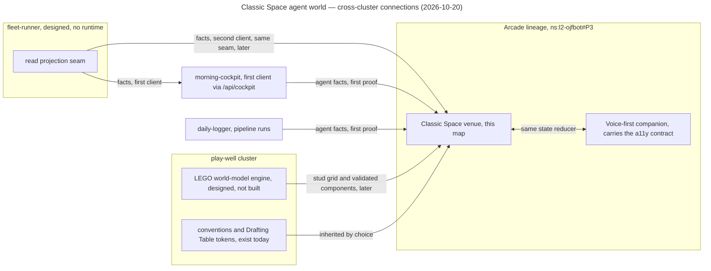

# Wayfinder — Classic Space agent world

## Destination

The Arcade gains an ambient venue. A Classic Space server room — 1980s LEGO space illustration,
blue spacemen, black contours — runs all day on a desk monitor, and every minifig in it is a real,
named ojfbot agent, process or queue. A glance reads status; selecting a figure or place reveals
the real entity, its task and its evidence; a plain dashboard/text view renders the same state in
parity; a stale or disconnected feed says so in both surfaces. **Arrived** = one cluster room bound
to one real read-only fleet feed, two or more minifigs on independent validated routes, the plain
view in parity, deterministic replay for regression, and layout, labels and overrides that survive
restart. Serves `ns:l2-ojfbot#P3` (the Arcade fronts the fleet) and `ns:l2-ojfbot#P1` (each app
reaches a usable surface in its natural venue). The minifig is the flâneur of the Arcade's own
naming register (name the operating surface, #273).

It is a **novel representation stack over the same shared agent state** the rest of the fleet
reads — a UI layer, not a second source of truth — so it binds to fleet-runner's object model as
that work lands, through the same read seam morning-cockpit uses as fleet-runner's **first
client surface**; this venue is the second. The **play-well cluster is the engine for building
any LEGO world model**, so the room's geometry, stud grid and validated components integrate
closely with play-well's tooling rather than growing a private world model. It is **resolutely visual** and built as a design experiment for the operator
alone. A **voice-first companion surface** runs side by side with it, equal in *capability*
(every entity, state and action the scene shows is reachable by voice) and accessible at all
times; the accessibility-tree contract governs the companion, and the canvas is exempt. First
proof tracks the agents of **morning-cockpit** and **daily-logger**.

The initiative consumes the play-well cluster's tools — Drafting Table tokens, the LEGO building
UI, Blender expertise — as a client cluster and contributes features back, the way other clusters
are meant to consume blogengine's publishing harness without joining its cluster. It does not join
play-well's correspondence register unless the repo-home ticket rules otherwise. Siri as a
transport, camera moves, node authoring and further rooms are beyond arrival (see fog and
out-of-scope below).

## Notes

- **Mode:** full (core registry resolves, 26 entries). Charted 2026-10-20 from
  `lego-village-pipeline` as the vantage; the map lives here in the one library.
- **Source bundle:** `~/Desktop/classic-space-walkway-pass` — a ChatGPT-session handoff with
  honest provenance: a Three.js projection scene (approved plate camera-projected onto rough
  solids), one procedural rigid minifig on one route, fixed art camera, 36 s loop at 24 fps;
  Chromium captured, FFmpeg encoded; **Blender never ran**; no fleet schema inspected. Read
  `START_HERE.md`, `AGENTS.md`, `handoff/PRODUCT_VISION.md`, `handoff/OJFBOT_WORLD_COMPILER.md`,
  `handoff/KNOWN_LIMITATIONS.md`, `handoff/NEXT_LAYOUT_CHANGE.md`. The bundle's `AGENTS.md`
  standing rules (preserve the visual contract; work honestly and incrementally; never claim a
  Blender run or render without evidence) are inherited verbatim as working constraints.
- **Why "fork from LVP" is weaker than it sounds.** LVP is a procurement digital twin that spends
  real money against a BOM; this is an ambient agent-ops venue. What carries over is conventions
  (teacher principle, evidence axes, a11y-tree contract, Drafting Table tokens at
  `docs/design/H-01-R1/dt/tokens.css`, mock-math labelling, people rules: James is a friend of
  the family, never a parental role; the boys are EH, HH, LH), not domain. The real precedent is
  the Arcade lineage.
- **The Arcade is the home, by name already.** `operating-surface-bonded-pair` (#272) closed
  "name the operating surface" (#273) on 2026-07-23 with Benjamin's *Arcades Project* as the
  register: one passage, many worlds; the operator as flâneur. No visual "see the fleet" attempt
  has been filed under it: `core-library` (May 2026, "3D cyberspace navigation UI for deployed
  apps + running agents", Babylon, wireframe Cambridge UL aesthetic) is a three-commit seed with
  undeclared scope and no northstar; cockpit tiles and gastown-pilot are separate apps. This map
  is the first Arcade *venue* initiative. Cross-map dependencies: registry schema home (#275) and
  tier B talk seam (#281) remain open there.
- **"The ojfbot schema" does not exist as one thing.** fleet-runner is design-only
  (`fleet-runner/` holds planning and research; placement approved in core as
  `packages/fleet-runner`, ADR-0108; no runtime). What is observable today: the live Claude Code
  session census (the UserPromptSubmit hook lists ~40 worker agents by repo), beads under
  `.handoff/` (typed, dated, with refs and status), `decisions/northstar/status.jsonl`
  (movement ledger, sparse), the northstar registry and roadmaps, GitHub issues/PRs/sub-issues,
  the daily-logger sweep. The first feed is a research question, not a lookup.
- **Two engines, both designed-not-built (2026-10-20).** fleet-runner has no runtime; its
  planning names cockpit's existing REST `/api/cockpit` as the first publication path (a
  read-only evidence card), which makes cockpit the first client and this venue the second,
  sharing that seam. The play-well cluster has no world-model code yet: LVP's `tools/` are
  register, preflight and design-package tooling, its roadmap's only slice is the Q13 railbed
  geometry check, and the LEGO world-model engine (ldraw-nova precedent, stud-grid geometry,
  validated components) is a research-lane vision under the 2026-10-21 ORDER-BY gate. The first
  proof therefore runs on what exists — the projection scene and cockpit/daily-logger facts —
  with explicit seams left for both engines, and never claims either is in the loop until it is.
- **Governance fact:** `REGISTER.md` scope text — "the play-well cluster, not one repo … and any
  further play-well repo" — means calling this repo play-well pulls it under memo preflight,
  register versions and relay-only self-merge. Membership is a decision (repo-home ticket).
- **Vault reads (design-time, read-only):**
  - `synthesis/play-well-research-harness` — the decomposition alarm and innovation alarm apply
    to any "ahead of the field" claim this venue makes; keep candidate modules as findings until
    decided.
  - `concepts/blender-era-3d-work` — the practice's craft → script → agent arc; a 2019 "rough
    server-room blockout" and a 2021–22 LDraw import pipeline are literal ancestors of this room.
  - `synthesis/cluster-status`, `synthesis/ojfbot-ecosystem-map` — the `core-library` seed and
    `asset-foundry` (LangGraph → bpy → validated .glb, generic by construction) as the fleet's
    Blender capability.
  - `synthesis/fleet-runner-design-contracts` — user story 8 ("truthful blocked, unknown and
    stale states so process health does not masquerade as progress") is the fleet's own statement
    of this venue's honesty rule.
- **Standing constraints carried from the handoff:** a walking minifig never implies a live task
  succeeded; a metaphorical walk down a garbage lane never itself triggers deletion; queue visuals
  may aggregate while the dashboard keeps exact counts; simulation time stays separate from render
  frame rate; mock data is labelled simulated.
- **Tooling pointers (not endorsements):** Mint MCP / mint-threejs-skills, `ahujasid/mcp-for-blender`,
  the Blender MCP connector attached to this session, `asset-foundry`'s subprocess bridge. Evaluate
  any generator on one small module before widening (handoff `TOOLS_AND_PRECEDENTS.md`).

## Integration notes (cross-cluster)

Operator instruction, 2026-10-20: this is one of the first initiatives with robust overlapping
concerns and one-to-many connections between clusters (Arcade lineage · fleet-runner via the
cockpit seam · play-well as world-model engine · daily-logger as a feed). Keep notes on how the
integration behaves, the patterns established, the friction points, and how to integrate such
processes going forward. **Convention:** friction met while working a ticket or slice goes to
`implementation-notes.md` `## Deviations` in the repo where it happened (the fleet's existing
roll-up finds repeats); patterns and seams get a dated bullet here while the map is open; at
handoff this section graduates to a vault synthesis (candidate: `cross-cluster-consumer-pattern`)
and, where a convention emerges, an ADR. Seeded from this charting session:

- **Consumer of a consumer.** fleet-runner → cockpit (`/api/cockpit`, first client) → this venue
  (second client). Pattern: a second surface reads the *same* seam as the first; never scrapes the
  first surface. Friction: the seam is designed-not-built, so the venue's first proof reads
  cockpit and daily-logger facts directly and must leave the seam swappable.
- **Engines that do not exist yet.** Both named engines (fleet-runner runtime, play-well world
  model) are visions with research behind them. Pattern: name the seam, run the proof on what
  exists, never claim the engine is in the loop. Friction: every ticket touching those seams
  carries a "now vs later" split.
- **Governance by label.** A cluster's register can claim a repo by scope text alone. Pattern:
  cluster membership is a decision ticket (home), decided before any landing, not inferred from
  aesthetic or tooling overlap.
- **Contracts that assume a DOM.** LVP's a11y-tree-as-agent-contract cannot see a WebGL canvas.
  Pattern: the contract moves to a companion surface equal in capability. Friction: "equal" needs
  a definition per surface pair.
- **The blogengine-consumer pattern is still a vision.** Operator framing: other clusters consume
  blogengine's publishing harness without joining its cluster. No cluster does so yet, so this
  venue may be the first realisation of that pattern and should record what it takes.
- **Where cross-cluster work lives.** Today the only neutral home is this map in core's library.
  Friction: the source bundle sits on the Desktop with no git history until the home ticket rules.

### Who feeds whom (context view, 2026-10-20)

**Caption:** For the operator: which clusters and apps this venue depends on, and in which
direction facts flow. Notation: a dependency/context view drawn as a Mermaid flowchart, not C4 or
OPM. Key: a label ending in "designed, no runtime" or "designed, not built" marks a thing that
does not exist yet; an edge label ending in "later" marks a connection that is planned, not live.
Takeaway: the only live inputs for the first proof are cockpit and daily-logger agent facts plus
play-well's conventions; both engines are seams left open. Omitted: Siri, Blender's role, the
correspondence register, and the Arcade map's own open tickets. Rendered with
`@mermaid-js/mermaid-cli` 11.4.2 (`securityLevel: strict`, `htmlLabels: false`).

## Decisions so far

Grill-resolved at charting (recorded here as pre-map rulings by Yuri, 2026-10-20, not closed
tickets):

- Home lineage is the **Arcade**, as the next iteration attempt; play-well is consumed as a tool
  well, blogengine-consumer pattern — ruled in the charting grill (anchor `ns:l2-ojfbot#P3`, `#P1`).
- Arrival requires **one real read-only feed**, not replay alone and not Siri — ruled in the
  charting grill.
- Camera moves/transitions, node-based room authoring and multiple rooms are **out of scope** —
  ruled in the charting grill.
- Second round, same session: the scene is **resolutely visual and for the operator alone**; the
  a11y-tree contract is carried by a **voice-first companion surface**, equal in capability and
  accessible at all times, not by the canvas.
- Second round: the first proof tracks **morning-cockpit and daily-logger agents**; the venue is a
  **representation stack over shared agent state** and binds to fleet-runner's object model
  rather than inventing a parallel schema (the handoff's Agent/Place/Lane/Task/Event proposal is
  a candidate projection, not the source model).
- Third round: **morning-cockpit is fleet-runner's first client surface**; this venue consumes
  the same read seam as the second client, never a private scrape of cockpit.
- Third round: the **play-well cluster is the engine for any LEGO world model**; the room's
  spatial definition integrates closely with play-well's tooling as that engine lands, which
  raises (not settles) the register-governance question in the home ticket.

Closed tickets: none yet.

## Tickets

| Ticket (title, refer-by-name) | Type | Blocked by | Status |
|-------------------------------|------|------------|--------|
| Repo and northstar home (#542) | grilling | — | open |
| Observable fleet state survey (#543) | research | — | open |
| Blender's role in the loop (#544) | grilling | — | open |
| Two-agent route proof on the projection scene (#545) | prototype | — | open |
| Reacquire the measured minifig references (#546) | task | — | open |
| First feed binding (#547) | grilling | Observable fleet state survey | open |
| Arcade seam (#548) | grilling | Repo and northstar home | open |
| Play-well consumption contract (#549) | grilling | Repo and northstar home | open |
| Ambient host and display operations (#550) | grilling | Repo and northstar home | open |
| Authoritative spatial source (#551) | grilling | Blender's role in the loop; Two-agent route proof on the projection scene | open |
| State vocabulary and honesty rules (#552) | grilling | First feed binding | open |
| Yellow lane semantics (#553) | grilling | First feed binding | open |
| Minifig fidelity bar (#554) | grilling | Reacquire the measured minifig references | open |
| Voice-first companion surface (#555) | grilling | State vocabulary and honesty rules | open |
| Room document and restart survival (#556) | grilling | First feed binding; Authoritative spatial source | open |

Frontier at charting: Repo and northstar home · Observable fleet state survey · Blender's role in
the loop · Two-agent route proof on the projection scene · Reacquire the measured minifig
references. Research runs one cycle at a time; the survey is the only research ticket.

Deliveries deliberately **not** on this map (they are roadmap slices once the decisions above make
their entrance statable): the longitudinal yellow gangway layout pass (`NEXT_LAYOUT_CHANGE.md`),
the production two-agent slice, the semantic vertical slice with replayed inspection and archive
tasks, character interaction clips, and the baseline commit of the bundle into whatever repo the
home ticket names.

## Not yet specified

- **Siri as a transport** — operator intent is clear ("quick queries and interactions via Siri");
  the companion surface is now a ticket, but whether Siri fronts it is not statable until that
  ticket fixes the companion's API.
- **Feed cadence versus an animated room** — daily-logger fires once a day and cockpit runs on
  launchd; if per-phase progress is not observable, the room stands still most of the day. The
  survey reports cadence; whether the live session census joins the first feed is a later question.
- **Interaction vocabulary** — inspect panel, carry archive capsule, pause at a busy junction,
  acknowledge-attention gesture; depends on the state vocabulary.
- **Queue aggregation visuals** — how many items become one visual summary, and what the summary
  may hide; depends on the bound feed's queue shape.
- **Contribution path back to play-well** — which play-well tool receives its first feature from
  this consumer (tokens, building UI, Blender recipes); depends on the consumption contract.
- **Generative asset tooling** — whether Mint, `generate_3d` or asset-foundry supply candidate
  modules; depends on Blender's role.
- **Level connector behaviour** — lift/stairs traversal and reservations; depends on the
  authoritative spatial source.

## Out of scope

- **Camera moves and transitions** — ruled by Yuri, 2026-10-20 (charting grill). The art camera
  stays fixed until layout and behaviour are dependable.
- **Node-based room authoring** — ruled by Yuri, 2026-10-20. The world-compiler node editor waits
  until one real cluster compiles into agreed scene and dashboard state.
- **Multiple rooms** — ruled by Yuri, 2026-10-20. One room is the proof; rooms-as-clusters is a
  later initiative.
- **Family-facing use** — ruled by Yuri, 2026-10-20: "a design experiment and for myself." The
  people rules still apply to any copy, but the family-surface requirements of LVP P3 do not.
- **Canvas accessibility** — ruled by Yuri, 2026-10-20: the scene is resolutely visual; the
  accessibility contract lives in the companion surface (ticket), never in the WebGL canvas.
- **Touching lego-village-pipeline** — stated in the charting brief: this initiative reads LVP
  for precedent and never edits it.
