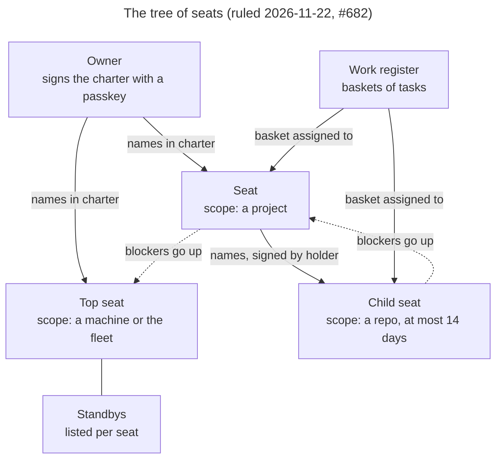
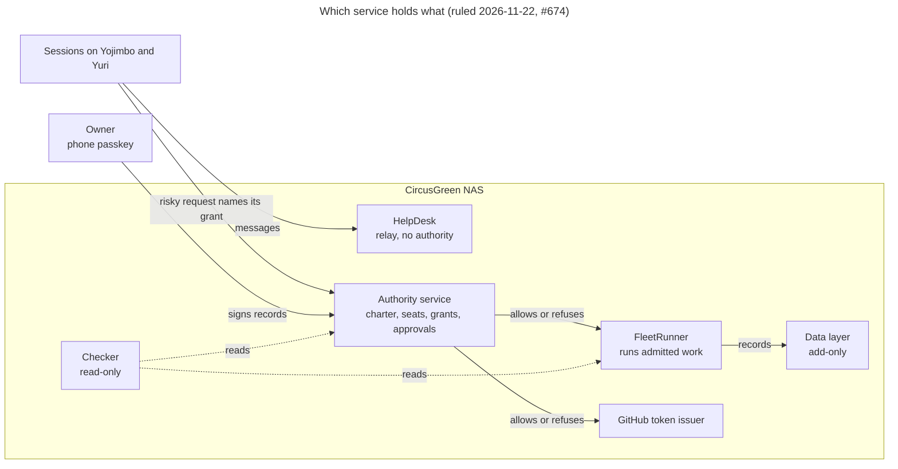
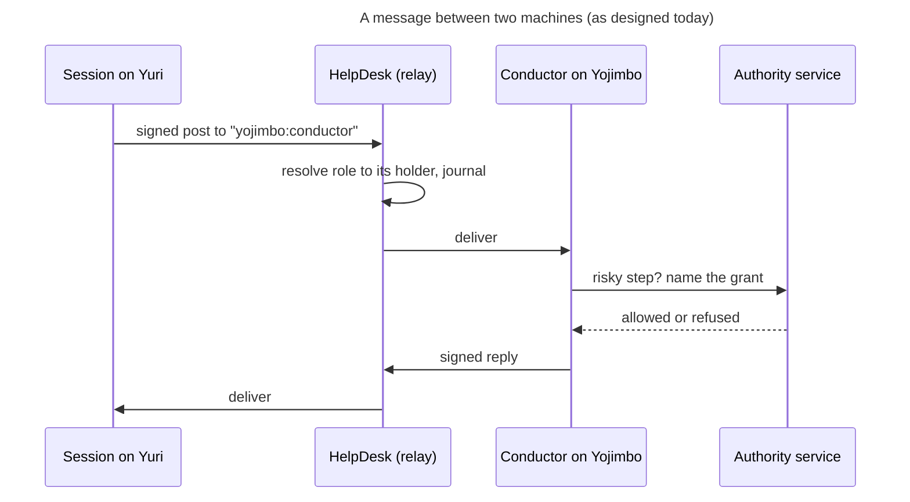
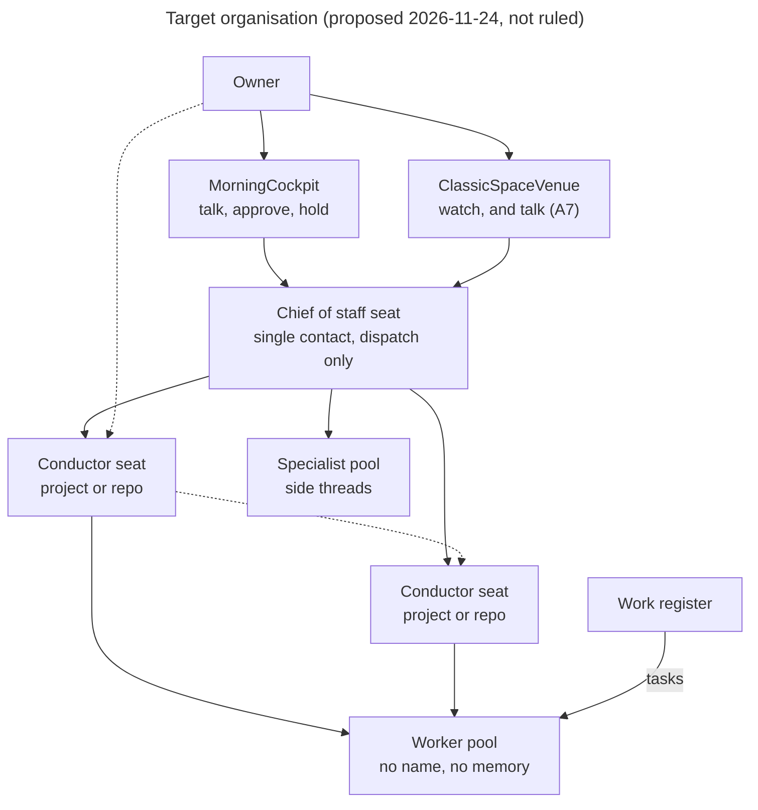
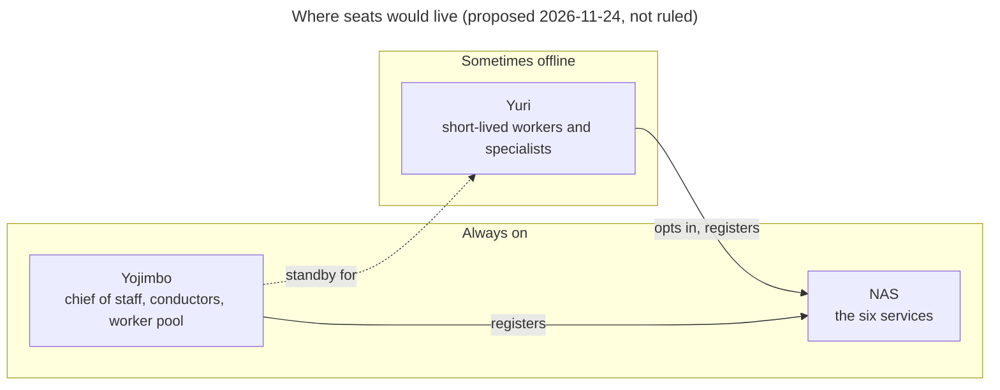
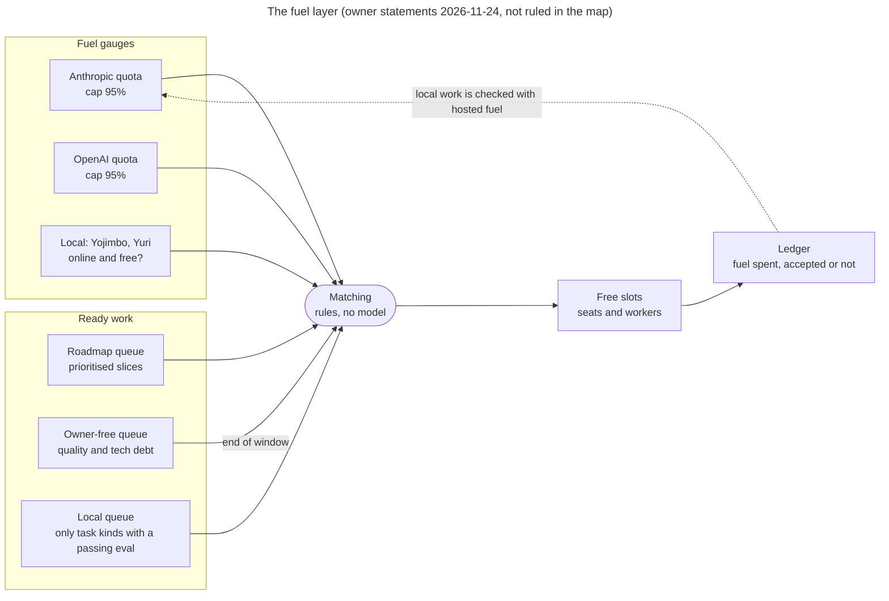

# CircusGreen: who the agents are and how they talk

**Status: draft overview, 2026-11-24. Not reviewed, not challenged, not merged.**

This page explains, in one place, how CircusGreen's agents are organised and how they
correspond across tools (Claude Code, Codex) and machines (Yojimbo, Yuri, the NAS). It does
two jobs and keeps them apart:

- **Sections 1 to 6 restate what the owner has already ruled.** The rulings are in
  [`decisions/wayfinder/agent-trust-and-factory-evaluation.md`](../decisions/wayfinder/agent-trust-and-factory-evaluation.md)
  (22 November 2026). This page adds no authority to them. Where the two disagree, the map wins.
- **Section 7 lists what the owner said on 24 November 2026** (A1 to A9) that is not yet in the map.
  They are entered in the map as an owner addendum dated 2026-11-24, in the same pull request as this page. They have not been ticketed or challenged yet.

"Ruled" does not mean "built". Section 8 says what this page could and could not confirm
about the built state.

## 1. The design in one paragraph

CircusGreen is organised as **seats**, not chats. A seat is a lasting job with a scope. A
chat session holds a seat for a while and can be replaced without the job changing. Seats
form one tree. The owner names the long-lived seats in a charter signed with a phone
passkey, and those seats may name one level of child seats. Work is recorded in a work
register as baskets of tasks, and problems travel up the tree seat by seat. **HelpDesk**
carries the messages and holds no authority. A separate **authority service** holds the
seat tree, the grants and the owner's approvals, and is the one place decisions are checked.
**FleetRunner** runs admitted work. Screens such as MorningCockpit show and steer this; they
do not own it.

## 2. Words

Each term is used here as the map rules it. The ticket that ruled it is in brackets.

| Word | Meaning |
|---|---|
| **Session** | One keyed chat. Its identity is its name plus the registration it signed a post under. (#663) |
| **Actor** | Who really acts behind a session. (#663) |
| **Seat** | A place in the conductor tree: a lasting job with a scope (which Macs, repos, actions and basket). A seat's scope fits inside its parent's. (#682) |
| **Conductor** | The holder of a seat. A type with tiers: there may be one for a whole machine, one for a project, one for a repo. (#682) |
| **Charter** | The record the owner signs with their passkey. It names the top seats, each seat's holder by session name and key, and ordered standbys. (#666, #679) |
| **Child seat** | A seat named by a parent seat's holder, one level down. Lasts at most 14 days. (#680, #682) |
| **Standby** | A listed session that can take over a seat. (#666) |
| **Basket** | A work-register record grouping tasks. A task sits in at most one basket. (#682) |
| **Grant** | Checkable authority. A message from a peer is never a grant, and neither is a role address. (#663) |
| **Work grant** | A record that lets work be passed on. Lasts at most 3 days and carries a count of hops left. (#680) |
| **Role address** | A name a session claims so others can write to it, such as "the conductor on Yojimbo". An address only. No role carries authority. (#663, LocalHelp `docs/protocol-decision.md`) |
| **Approval** | One owner decision with its own identity, used once, valid 24 hours. (#679) |

Two words to avoid: **"coordinator"** (ruled out in #663) and **"conductor" in its old
sense**. Before October 2026 "conductor" named the control-plane project that FleetRunner
replaced (see `CONTEXT.md`, *Fleet-runner*). It now means a seat holder.

## 3. The tree of seats

**Caption:** The owner signs one charter naming the long-lived seats. Each seat's scope sits
inside its parent's. A parent seat's holder may name one level of child seats. Tasks are
grouped in baskets held in the work register, and a seat is assigned baskets. Blockers go up
one seat at a time, and the parent seat settles clashes between its children. Solid arrows
are "names and scopes"; the dotted arrow is "reports up".

How a seat changes hands (#666). There are only three ways:

1. The owner moves it.
2. The holder signs a handover to a listed standby.
3. The first standby takes over after HelpDesk's registry shows the holder has lapsed for
   12 hours. A warning goes out at 6 hours and an alert at takeover.

A replaced conductor stays replaced. Ending a seat or grant ends everything below it (#680).

## 4. Which service holds what

**Caption:** Six services run on the NAS. HelpDesk is a small relay: messages, presence,
session registration, role mailboxes, sign-in and the alert route. It holds no authority.
The authority service is the one decision point: it holds the owner's records, the seat
tree and standbys, the grants and the run counter. FleetRunner runs admitted work. The
token issuer hands out narrow GitHub credentials. The checker only reads. The data layer
only adds. Each service keeps its own journal, and a read-only linker rebuilds the chain of
evidence across them (#668, #674).

Rules that follow from this split:

- **Only services a Mac cannot reach enforce anything** (#667). A rule that lives only in
  an agent's instructions is a declaration, checked afterwards.
- **If the decision point cannot be reached, new and risky work stops** (#667, #680).
- **An agent's own account is a claim.** The service that acted writes "observed" (#668).

## 5. How correspondence moves today

**Caption:** A session registers with HelpDesk and may claim a role address on its own
device. Another session writes to that address. HelpDesk resolves the address to whoever
holds it, delivers the message and journals both. Nothing in this path grants authority: if
the message asks for something risky, the receiver's request still has to name a grant that
the authority service checks.

What the existing documents already require of correspondents (LocalHelp
`docs/charter-coordination.md`, `docs/request-convention.md`; Core
`domain-knowledge/universal/agent-defaults.md`):

- A request states the work, the authority it rests on, the scope, who owns the effect,
  what evidence closes it and when to check back.
- Relayed authority is never assumed. A signature identifies a device and session, not the
  owner.
- Whoever sends a request owns the loop until it is closed or handed over.

What the existing documents **do not** say: who may write to whom. Any registered session
can post to any address. Section 7, amendment A1, is about that gap.

## 6. Screens

| Screen | Ruled purpose | Boundary |
|---|---|---|
| **MorningCockpit** | The owner's signed-in place to inspect, answer, approve, hold and follow results. | The owning services commit effects. The cockpit does not. |
| **ClassicSpaceVenue** | A spatial view where figures stand for live agents and tasks, read from FleetRunner. | Recorded so far as view-only. Animation must not imply real progress. See A7. |
| **Fleet board and ambient displays** | Status and evidence. | Show "stale" and "unknown" honestly. Hold no credentials. |

## 7. Amendments from 24 November 2026

The owner said these in a Claude Code chat on Yuri on 24 November. They are not yet in the
map. Each needs entering there, and the challenge rule (#664) applies to them as to any
design. "Fit" is this page's reading, not a ruling.

| # | Owner's statement | Fit with the 22 November rulings |
|---|---|---|
| **A1** | All correspondence between sessions goes through a conductor, never session to session directly. This includes anything from Yuri to Yojimbo. | **New.** Nothing ruled restricts who may send. Purpose given: one accountable voice per piece of work. Trigger: two helper sessions both wrote to Yojimbo about one issue and produced duplicate pull requests. |
| **A2** | There can be several conductors, conductors can have child conductors, and a conductor does not have to route ordinary messages through its parent. | **Fits.** The owner ruled the scope on 24 November: "Only ordinary messages". Conductors may write to each other directly. Blockers still go up seat by seat, as #682 says. |
| **A3** | The rule restricts sending only. Any session may read shared threads, and the owner may talk to any session directly. | **New, no conflict found.** |
| **A4** | Agents follow the written rule first, and HelpDesk records messages that break it without blocking. Blocking comes later, once the record shows the rule works. | **Fits the build order** (watch-only before enforcing). Note #667: a rule that only agents follow is a declaration, not enforcement. |
| **A5** | Orchestration is separate from HelpDesk and from conductors. It holds the whole picture: what work exists, what kind of session suits it, how sessions relate. It starts as a record; a model with its own dedicated context comes after. | **Partly ruled already.** The record exists in the design as the work register and the seat tree. The model with its own context is new. Where it lives relative to FleetRunner is open. |
| **A6** | Seats come in kinds: a chief of staff as the owner's single point of contact, conductors, a small pool of specialists for side threads, and pooled workers. | **New.** #682 leaves seat labels open, so kinds can be added without changing the tree. |
| **A7** | ClassicSpaceVenue is a place the owner talks to agents, not only watches them. It uses the same sign-in as MorningCockpit. | **Changes a recorded boundary.** It was recorded as view-only. The owner ruled both points on 24 November ("Talk there too", "Yes, same sign-in"). Approvals stay passkey-signed whichever screen is used (#679), so the venue needs no approval power of its own. |
| **A8** | Long-lived seats run as deployed services on Yojimbo and the NAS. Yuri is a laptop, sometimes offline, and opts in for short-lived instances. | **New, fits.** The standby and 12-hour lapse rules (#666) already cover a holder going offline. |
| **A9** | A fuel layer assigns prioritised work to whatever capacity is free. Hosted quota is capped at 95% so the owner keeps a margin. Work that does not need the owner (quality, tech debt) is held for the end of a quota window, not front-loaded. Local models and hosted models are separate fuels with separate queues. | **New.** The first concrete input to the open budgets question in the fleet-runner map (#675); it extends that question and must not become a second budget model. It also bears on the cost measure in #672. See "The fuel layer" below. |

One recommendation made on 24 November is **withdrawn**: "whoever starts a helper session
is its conductor". Under #682 a conductor holds a named seat with a signed record. A session
that merely starts helpers does not. The plainer rule is: a helper session reports to the
session that started it, and only a seat holder is a conductor.

### The organisation the amendments describe

**Caption:** This is the target the owner described, drawn on top of the ruled seat tree.
The chief of staff is a seat whose job is to take the owner's requests, hand them to the
right seat, follow them and report with links to evidence. It dispatches and does not do the
work, so that the single contact does not become the bottleneck. Specialists take side
threads. Pooled workers have no name or memory and take tasks from the work register. Every
box except the owner is **proposed**, not ruled. Dotted lines are "may talk to directly".

### Where seats would live

**Caption:** Long-lived seats sit on machines that are always on. Yuri holds only
short-lived instances, or a seat that has a standby elsewhere, so that closing the laptop
never strands a job others depend on. Proposed under A8.

### The fuel layer

Stated by the owner in the same chat on 24 November. Not yet in the map.

"Fuel" is capacity to run agents. There are two unlike kinds, and they are never pooled:

| Fuel | What it is | Limit | State today |
|---|---|---|---|
| **Hosted, Anthropic** | Subscription quota for Claude, per account and per quota window | 95% cap | A 95% alert is live. A usage reader is merged and not switched on. |
| **Hosted, OpenAI** | Subscription quota for Codex, per account and per window | 95% cap | Not confirmed whether remaining quota can be read. |
| **Local** | What Yojimbo and Yuri can run themselves with open models, given whether each is online and free | The machine | Tried a few times, not proven. No repeatable eval harness exists. |

The owner's rules:

1. **Cap hosted fuel at 95%.** The last 5% is the owner's own margin.
2. **Do not burn quota for its own sake.** Early in a window, fuel goes to prioritised roadmap work.
3. **Hold owner-free work for the end of a window.** As a reset approaches, unspent fuel goes to a standing, prioritised list of quality and tech-debt work that does not end at the owner's desk.
4. **Keep separate queues per fuel.** A task says which fuel it can run on. Local work is not free: checking it costs hosted fuel, and that cost is counted.
5. **Local fuel earns work through evals.** Until a kind of task has a repeatable test that a local model passes, it is not assigned to local fuel.

**Caption:** Three gauges feed one matcher. The matcher takes the highest-priority ready task that fits a free slot of the right fuel. Near the end of a quota window it switches to the owner-free list, and it stops assigning hosted work at 95%. Every run is written to a ledger with what it cost and whether it became an accepted change. Everything here is proposed; nothing is built except the 95% alert.

What the layer is for, beyond scheduling: the owner will consider buying more local hardware
(a larger Mac Studio or NVIDIA Sparks) only if, within one to two months, the ledger shows a
stable queue that keeps the present two Macs working on tasks a local model demonstrably
does well. Busy hardware alone is not the evidence. The evidence is a list of task kinds
with passing evals, a queue of them deeper than the two Macs can clear, and an owner review
backlog that is not growing.

## 8. Ruled, proposed and built

This page was written from the documents. It did not inspect the running services.

| Piece | Ruled | Built |
|---|---|---|
| HelpDesk relay, session identity, role addresses | Yes | Yes. Device release 0.9.13 was installed on Yuri on 22 November 2026. |
| One role holder per device | Yes (LocalHelp protocol decision) | Yes. Several conductors on one Mac will need distinct role names. |
| Seat tree, charter, standbys, handover | Yes (#682, #666, #679) | Not confirmed. Sliced into roadmap phases PH8 to PH13; "seats and stops" is the last phase. |
| Authority service, token issuer, checker, data layer | Yes (#674) | Not confirmed. |
| Work register and baskets | Yes (#682, fleet-runner map #675) | Not confirmed. |
| Sending only through a conductor (A1) | No | No. Followed by convention in Claude sessions on Yuri since 24 November. |
| Chief of staff, specialist pool, seat kinds (A6) | No | No. |
| Orchestration with its own model context (A5) | No | No. |
| Fuel layer: gauges, queues per fuel, matcher, ledger (A9) | No | No, except the 95% quota alert, which is live. |
| Repeatable eval harness for local models | Tests lane, PH13 | Not confirmed. The owner reports it is not repeatable yet. |

## 9. Open questions

1. **A1:** a session the owner starts that holds no seat: which conductor does it send through?
2. **A1:** is the rule worth its cost? Steve Yegge's Wheelhouse runs about 50 agents with
   agent-to-agent mail and broadcast, and governs who may act, not who may talk.
3. **A5:** is the orchestrator an agent seat (as Wheelhouse's executive team is), a
   mechanical service on a workflow engine (as in Yegge's Counting House), or both under
   different names? How does it relate to FleetRunner?
4. **A6:** what stops the chief of staff from doing work itself?
5. **Fuel:** can remaining OpenAI quota be read at all? Which service holds the gauges and the ledger: FleetRunner's work register, or something new?
6. **Fuel:** tech-debt work still ends in pull requests, and agents merge only after the owner's yes (#681). What makes "owner-free" work truly owner-free: one batched yes, or a class of change that needs none?
7. **Build order:** if seats are the foundation for the organisation in section 7, should
   "seats and stops" stay the last trust phase?
8. **Reach:** the 24 November statements are known only to Claude sessions on Yuri. Codex on
   both Macs and Claude on Yojimbo learn them only when they are entered in the map and the
   shared instructions.

## 10. Prior art read for this page

Notes on each are filed in the owner's Selfco vault under "Yegge 2026 essays" and two talk
notes. In short:

- **Wheelhouse** (Yegge's software factory): an organisation chart, not a tool. A founder,
  an executive team (chief of staff, operations lead, infrastructure officer,
  internal-affairs judge), a named engineering crew, pooled headless workers and a few
  specialists. Run by doctrine and blame-free reviews, with no sandbox.
- **Counting House** (his pattern for high-volume casework): the opposite. Stateless
  one-shot agents that may only propose; a mechanical orchestrator on a durable workflow
  engine carries out what they propose; a policy table decides which model may do which work.
- Both treat token supply ("fuel") as the binding limit.

CircusGreen takes Wheelhouse's shape and adds what Wheelhouse leaves out on purpose: signed
charters and a decision point the agents cannot reach.

## Sources

- `decisions/wayfinder/agent-trust-and-factory-evaluation.md` (rulings #663 to #682)
- `CONTEXT.md` (Fleet-runner, and the earlier meaning of "conductor")
- LocalHelp `docs/protocol-decision.md`, `docs/session-identity.md`, `docs/charter-coordination.md`, `docs/request-convention.md`
- `domain-knowledge/universal/agent-defaults.md`
- Owner statements, Claude Code chat on Yuri, 2026-11-24
